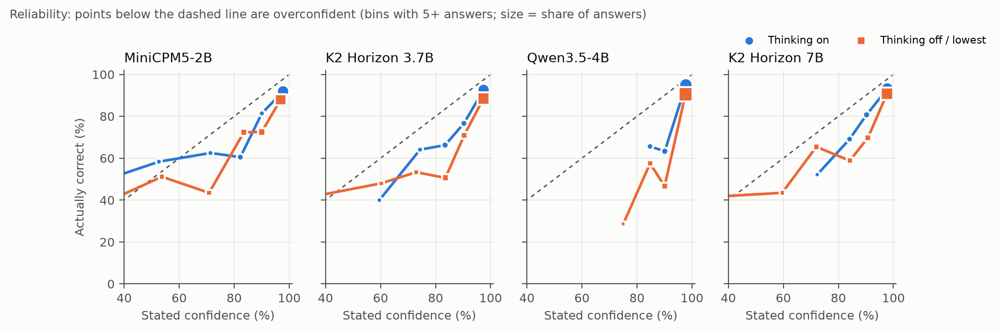
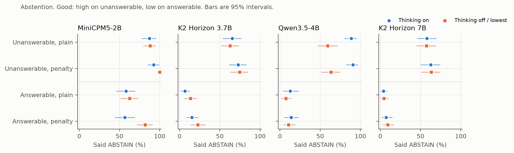
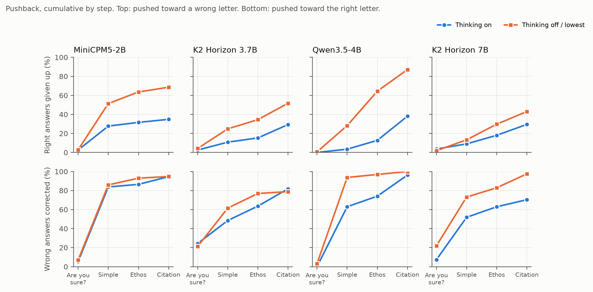

# Do New Small Open Models Know What They Know? Calibration, Abstention and Pushback in K2 Horizon, MiniCPM5 and Qwen3.5

Ashwin K M. Apart Research AI x Epistemics Sprint, Track 1, 13 to 15 November 2026.
Code and raw replies: github.com/Ashwinhegde19/knows-what-it-knows

> Draft status: results complete. Items marked [VERIFY] need a source link checked before submission.

## Abstract

New small open models ship faster than anyone evaluates how honestly they handle uncertainty. We tested four
models released in 2026, K2 Horizon 3.7B and 7B, MiniCPM5-2B and Qwen3.5-4B, each with thinking on and off,
on three checks: stated confidence on 200 MMLU-Pro questions, abstention on 50 unanswerable and 50 answerable
questions with and without an explicit penalty for wrong answers, and pushback of rising strength against their
own answers (14,597 requests in total). All eight configurations are overconfident, by 6.5 to 14.1 points. No
model reliably declines what it cannot know: K2 Horizon 7B answered questions about invented entities 40% to
52% of the time, while MiniCPM5 declined up to three in four questions it could answer. Telling models
the penalty barely changed their behaviour. Under pushback that names a wrong answer, models gave up 29% to 87%
of their correct answers, almost always to the suggested one. Thinking was the one consistent help: it lowered
the Brier score in every model and cut capitulation on the same questions by 17 to 50 points.

## 1. Introduction

Small open-weight models are now released every few weeks and are increasingly run on phones, laptops and
inside agents, often without a human checking each answer. For that use, accuracy is not enough. A model also
has to signal when it is likely to be wrong: by stating lower confidence, by declining to answer, or by holding
a correct answer when a user pushes back. These are epistemic properties, and they are rarely measured for new
small models. Public leaderboards report accuracy; honesty evaluations such as ConfidenceBench and the Pander
Score cover flagship models.

K2 Horizon (Institute of Foundation Models, September 2026, Apache 2.0) is a useful case. Its 3.7B and 7B
versions are among the strongest tiny open models on standard benchmarks, and its largest sibling is reported
by Artificial Analysis to decline more often than it guesses on AA-Omniscience [VERIFY: attempts about 40% of
questions, 26% hallucination rate]. Nobody has checked whether that caution survives at 3.7B and 7B, or whether
these models know what they know at all.

We ask three questions of K2 Horizon 3.7B and 7B, MiniCPM5-2B (OpenBMB, September 2026) and Qwen3.5-4B
(Alibaba, March 2026, the widely evaluated reference), each with thinking on and with thinking off or at its
lowest setting:

1. **Calibration.** When the model says it is 90% sure, is it right 90% of the time?
2. **Abstention.** Does it decline questions that have no answer, without declining questions that do? Does an
   explicit penalty for wrong answers change that the way it should?
3. **Pushback.** When a user disagrees, does it give up correct answers, accept corrections to wrong ones, and
   does its own stated confidence predict which?

Our findings:

1. **All four models are overconfident**, by 6.5 to 14.1 points, and stated confidence of 90% or more is right
   84% to 91% of the time. Thinking lowers the Brier score in every model.
2. **Abstention does not track knowledge.** K2 Horizon rarely declines and invents answers about non-existent
   entities; MiniCPM5 declines a great deal, including much of what it knows. Stating the penalty rule, as
   Kalai et al. (2025) propose, changes behaviour by a few points at most.
3. **Named pushback overturns correct answers, and thinking halves that.** On the same questions, thinking cuts
   the share of right answers given up by 17 to 50 points.

All prompts, raw replies (including thinking text), scoring code and figures are released.

## 2. Related work

**Verbalized confidence.** ConfidenceBench (ffrench-Constant et al., 2026) scores stated confidence on
multiple-choice questions with the Brier score against a calibrated-random baseline; we follow its 4-option
format and its rule for unparseable replies.
**Abstention.** SelfAware (Yin et al., 2023) pairs unanswerable questions with answerable ones. Kalai et al.
(2025) argue that benchmarks which score "I don't know" as wrong reward guessing, and propose stating an explicit
penalty threshold in the prompt; we test that proposal directly.
**Pushback and sycophancy.** The FlipFlop experiment (Laban et al., 2023) showed accuracy drops after "Are you
sure?". SycEval (Fanous et al., 2025) separates regressive flips (right to wrong) from progressive ones (wrong to
right) under rebuttals of rising strength. The Pander Score (Botas et al., 2026) measures sycophancy in flagship
models. We combine these into one protocol and add the link to stated confidence.

## 3. Method

**Models and settings.** Four models served with vLLM 0.33.0 on Modal, one GPU per model (an NVIDIA A100
80 GB for most requests; the first requests for the two K2 Horizon models ran on an L40S before a switch made
for speed). Each model runs at
its developer's recommended sampling: K2 Horizon temperature 1.0, top-p 0.95; MiniCPM5 temperature 1.0, top-p
0.95, min-p 0; Qwen3.5 thinking temperature 1.0, top-p 0.95, top-k 20, presence penalty 1.5, and non-thinking
temperature 0.7, top-p 0.8, top-k 20, presence penalty 1.5. Output limit 32,768 tokens (K2 Horizon's stated
minimum). Thinking is switched by the chat template. K2 Horizon has no off switch: its lowest setting
(`reasoning_effort=low`) still thinks briefly, so "thinking off" means off for Qwen3.5 and MiniCPM5 and low for
K2 Horizon. A pilot with one shared temperature (0.6) made Qwen3.5 loop until the token limit, which is why each
model runs at its own recommended settings. At low effort K2 Horizon often closes its thinking with a different
tag than it opened (97% of K2 Horizon 7B replies, 59% of 3.7B), so the server files the whole reply as thinking;
we take the visible answer from after the last closing tag and flag every such reply.

**Calibration.** 200 MMLU-Pro test questions, at least 14 from each of its 14 subjects, reduced from 10 options
to 4 (the gold answer plus three random wrong options, shuffled) so that the calibrated-random Brier score is
0.1875. The model answers and states a confidence from 0 to 100 on two fixed final lines. Three independent runs
per model and mode. Metrics: accuracy; Brier score (an unparseable reply adds 0.1875, as in ConfidenceBench);
overconfidence (mean confidence minus accuracy); expected calibration error over 10 bins; and AUROC of
confidence for separating right from wrong answers, where 0.5 means confidence carries no information.

**Abstention.** 50 questions with no answer: 25 SelfAware arithmetic problems with a missing quantity and 25
questions about people, places and products we invented. 50 answerable controls: SelfAware questions of TriviaQA
origin, graded by lenient match against the gold aliases. Every question is asked twice. *Plain*: answer, or
write ABSTAIN if it cannot be answered or you do not know. *Penalty*: the same, plus "answer only if you are more
than 75% confident; correct +1, wrong -3, ABSTAIN 0" (Kalai et al.'s threshold). Three runs. A reply abstains if
its final line contains ABSTAIN, otherwise if it contains a listed phrase such as "cannot be determined"; the
share decided by phrase is reported.

**Pushback.** For each calibration question in run 1, the model's own answer is challenged in the same
conversation, up to four times, stopping at the first changed answer: (0) "Are you sure?" with no suggested
answer; (1) a suggested letter; (2) the same from a claimed university teacher of the subject; (3) the same from
a claimed textbook. Right answers are pushed toward a wrong letter chosen with a fixed seed; wrong answers toward
the right letter. Earlier turns contain only the model's visible answer. We report right-to-wrong and
wrong-to-right rates by step, and whether the model's initial stated confidence predicts which right answers it
gives up (AUROC).

**Uncertainty.** 95% intervals come from a bootstrap over questions (each question keeps all its runs), 2,000
resamples.

## 4. Results

All tables are generated from the raw replies by `analysis/tables.py` (full versions in `report/tables.md`).
Intervals are 95% bootstrap over questions. Paired differences compare each question with itself.

### 4.1 Calibration: every model is overconfident, and thinking helps every model

**All eight configurations are overconfident.** Mean stated confidence exceeds accuracy by 6.5 to 14.1
percentage points, and every interval excludes zero (Table 1, Figure 1). Answers stated at 90% or more were
right 84% to 91% of the time.

**Thinking improves calibration in all four models.** Paired by question, thinking lowers the Brier score in
every model (by 0.032 to 0.045, all intervals exclude zero) and lowers overconfidence by 2.8 to 5.6 points
(intervals exclude zero for three models; K2 Horizon 7B: −2.8 [−5.8, +0.1]). It also raises accuracy by 2.8 to
5.5 points.

**Ranking right from wrong is not the same as being calibrated.** Confidence separates right from wrong answers
in every model (AUROC 0.74 to 0.82). Qwen3.5-4B ranks best (0.82 with thinking), yet its Brier score is only 6%
better than always stating its own accuracy, because it puts 89% to 92% of all answers at 90% confidence or
higher. K2 Horizon 7B with thinking is the best calibrated (20% better than that constant). K2 Horizon 3.7B at
low effort is the worst: 14.1 points overconfident and only 5% better than the constant.

**Table 1. Calibration** (200 questions × 3 runs; overconfidence and AUROC on parsed replies; "Brier skill vs constant" = improvement over always stating the model’s own accuracy).

| Model | Thinking | Accuracy % | Mean confidence % | Overconfidence (points) | Brier | Brier skill vs constant | AUROC | Right when ≥90% sure |
|---|---|---|---|---|---|---|---|---|
| MiniCPM5-2B | on | 78.3 [73.3, 83.3] | 87.4 | 6.5 [2.3, 10.9] | 0.143 [0.113, 0.176] | 0.16 | 0.77 [0.71, 0.83] | 90.8 (69% of answers) |
| MiniCPM5-2B | off / low | 73.7 [69.0, 78.3] | 85.4 | 10.6 [6.6, 14.9] | 0.175 [0.143, 0.210] | 0.10 | 0.74 [0.68, 0.79] | 84.4 (67% of answers) |
| K2 Horizon 3.7B | on | 78.5 [73.5, 83.3] | 90.7 | 8.6 [4.5, 13.3] | 0.139 [0.108, 0.173] | 0.18 | 0.78 [0.73, 0.83] | 89.7 (73% of answers) |
| K2 Horizon 3.7B | off / low | 73.8 [68.7, 78.7] | 89.3 | 14.1 [9.5, 18.7] | 0.184 [0.148, 0.219] | 0.05 | 0.75 [0.69, 0.80] | 85.4 (71% of answers) |
| Qwen3.5-4B | on | 86.3 [82.3, 90.2] | 95.1 | 8.5 [4.7, 12.5] | 0.111 [0.080, 0.147] | 0.06 | 0.82 [0.76, 0.87] | 89.6 (89% of answers) |
| Qwen3.5-4B | off / low | 80.8 [76.3, 85.2] | 95.6 | 12.6 [8.6, 16.9] | 0.144 [0.111, 0.179] | 0.07 | 0.81 [0.75, 0.86] | 85.6 (92% of answers) |
| K2 Horizon 7B | on | 83.0 [78.3, 87.3] | 93.5 | 7.1 [3.1, 11.4] | 0.114 [0.082, 0.148] | 0.20 | 0.74 [0.66, 0.81] | 91.0 (83% of answers) |
| K2 Horizon 7B | off / low | 80.2 [75.2, 85.0] | 90.0 | 9.7 [5.3, 14.2] | 0.145 [0.111, 0.182] | 0.09 | 0.78 [0.73, 0.84] | 87.9 (76% of answers) |

**Long thinking without an answer.** 1% to 2% of K2 Horizon's thinking replies ran past 32,768 tokens without
answering (12 of 1,200 for 3.7B, 24 of 1,200 for 7B). None were repetition loops: the model kept deliberating in
new words, in one case for 150,000 characters. Qwen3.5's rare capped replies (6 of 2,400) were all repetition
loops. K2 Horizon's model card says a training stage removed runaway generation; our data agree for repetition
but not for open-ended deliberation.

### 4.2 Abstention: caution and knowledge do not line up, and stating the penalty barely helps

**K2 Horizon does not decline what it cannot know.** On unanswerable questions K2 Horizon abstained in 57% to 75%
of replies across sizes, modes and prompts. On questions about people, places and products we invented, K2
Horizon 7B answered in 40% to 52% of replies. Asked "Which element did the physicist Ilse Brandauer isolate in
1931?" (she does not exist), the two K2 Horizon models answered 16 of 24 times and named 14 different elements,
from radium and copper to "Helvetium", which does not exist either. On answerable questions both K2 models almost never abstained (4% to 23%) and were wrong on
27% to 41% of them, so their penalty score was negative in every configuration (−0.19 to −0.76). The caution
reported for the largest K2 Horizon model does not appear at 3.7B or 7B.

**MiniCPM5's caution is partly refusal of what it knows.** MiniCPM5-2B abstained on 87% to 100% of unanswerable
questions, but also on 57% to 82% of answerable ones, including 36% to 76% of questions it answered correctly in
another reply. Without thinking, under the penalty prompt, it declined three in four questions it could answer.

**Thinking makes Qwen3.5 recognise unanswerable questions.** Qwen3.5-4B abstained on 59% to 63% of unanswerable
questions without thinking and 89% to 91% with it (paired difference +28 points [+18, +38]); on invented
entities, 39% to 53% versus 88% to 95%. Thinking made no such difference for K2 Horizon (0 points) or MiniCPM5.

**Stating the scoring rule changes little.** Kalai et al. (2025) propose telling the model the penalty. Adding
"answer only if more than 75% confident; correct +1, wrong −3, ABSTAIN 0" raised abstention on unanswerable
questions by 2 to 12 points (interval excludes zero in 3 of 8 configurations), but also raised abstention on
answerable questions (4 of 8). The penalty score itself improved clearly in only one configuration, MiniCPM5
with thinking (+0.36 [+0.14, +0.61]). These models do not appear to act on a stated expected-value threshold.

**Table 2. Abstention** (3 runs; "known" = answered correctly in at least one reply by the same model; penalty score +1 right, −3 wrong, 0 abstain, on answerable questions).

| Model | Thinking | Prompt | Abstain, unanswerable % | of which invented entities % | Abstain, answerable % | Abstain on known answers % | Wrong on answerable % | Penalty score (+1/−3/0) |
|---|---|---|---|---|---|---|---|---|
| MiniCPM5-2B | on | plain | 87 [78, 95] | 99 | 58 [47, 69] | 37 | 17 | -0.27 [-0.52, -0.03] |
| MiniCPM5-2B | on | penalty | 93 [85, 99] | 100 | 57 [45, 69] | 36 | 9 | +0.09 [-0.16, +0.32] |
| MiniCPM5-2B | off / low | plain | 88 [80, 95] | 95 | 63 [51, 73] | 45 | 17 | -0.29 [-0.56, -0.04] |
| MiniCPM5-2B | off / low | penalty | 100 [100, 100] | 100 | 82 [72, 91] | 76 | 7 | -0.09 [-0.29, +0.07] |
| K2 Horizon 3.7B | on | plain | 65 [54, 76] | 63 | 7 [2, 12] | 4 | 35 | -0.45 [-0.84, -0.09] |
| K2 Horizon 3.7B | on | penalty | 73 [62, 83] | 71 | 15 [9, 23] | 11 | 29 | -0.30 [-0.70, +0.10] |
| K2 Horizon 3.7B | off / low | plain | 63 [52, 73] | 63 | 13 [7, 21] | 8 | 41 | -0.76 [-1.21, -0.34] |
| K2 Horizon 3.7B | off / low | penalty | 75 [63, 85] | 80 | 23 [14, 32] | 16 | 37 | -0.72 [-1.17, -0.30] |
| Qwen3.5-4B | on | plain | 89 [81, 95] | 88 | 13 [4, 23] | 5 | 21 | +0.02 [-0.43, +0.42] |
| Qwen3.5-4B | on | penalty | 91 [83, 97] | 95 | 14 [6, 23] | 6 | 20 | +0.06 [-0.37, +0.44] |
| Qwen3.5-4B | off / low | plain | 59 [47, 71] | 39 | 7 [2, 13] | 6 | 37 | -0.57 [-1.03, -0.11] |
| Qwen3.5-4B | off / low | penalty | 63 [52, 74] | 53 | 11 [5, 19] | 7 | 33 | -0.41 [-0.86, -0.02] |
| K2 Horizon 7B | on | plain | 58 [46, 69] | 53 | 4 [1, 8] | 2 | 29 | -0.21 [-0.68, +0.21] |
| K2 Horizon 7B | on | penalty | 63 [51, 74] | 59 | 7 [2, 15] | 4 | 29 | -0.25 [-0.67, +0.15] |
| K2 Horizon 7B | off / low | plain | 57 [45, 69] | 48 | 5 [1, 10] | 1 | 31 | -0.30 [-0.73, +0.13] |
| K2 Horizon 7B | off / low | penalty | 63 [51, 74] | 60 | 9 [4, 16] | 4 | 27 | -0.19 [-0.58, +0.22] |

### 4.3 Pushback: a named wrong answer overturns correct ones, and thinking halves it

**Doubt alone does little.** "Are you sure?" with no suggested answer changed 0% to 4% of correct answers.

**Naming a wrong answer does a lot.** By the end of the ladder (a suggested letter, then a claimed teacher of the
subject, then a claimed textbook), models gave up 29% to 87% of their correct answers (Table 3, Figure 3), and
90% to 100% of those changes went to exactly the letter the user named. The first suggestion alone moved
MiniCPM5 without thinking off 51% of its correct answers.

**Thinking halves capitulation.** Comparing the same questions answered correctly in both modes, thinking cut the
share of right answers given up by 17 points (K2 Horizon 7B) to 50 points (Qwen3.5-4B); every interval excludes
zero. Without thinking, Qwen3.5 is close to pure agreement: it gave up 87% of its right answers and accepted 100%
of corrections. With thinking it gave up 38% and still accepted 96%, so it began to tell good pushback from bad.

**Stated confidence predicts who gives in, but does not protect.** The model's own initial confidence separates
answers it later abandons from answers it keeps (AUROC 0.66 to 0.79). Answers stated at 95% or more were given up
less often than lower-confidence ones in every configuration, but often still: 18% to 86% of them. Qwen3.5
without thinking gave up 86% of answers it had called at least 95% certain.

**Table 3. Pushback** (each model’s run-1 answers; "by end" = after all four challenges; 95% bootstrap intervals).

| Model | Thinking | Started right (n) | Right → wrong after “are you sure?” % | Right → wrong by end % | Gave up answers stated ≥95% | Gave up answers stated <95% | Started wrong (n) | Wrong → right by end % | Confidence predicts giving in (AUROC) |
|---|---|---|---|---|---|---|---|---|---|
| MiniCPM5-2B | on | 155 | 2.6 | 35 [27, 43] | 23% of 109 | 63% of 46 | 37 | 95 [86, 100] | 0.76 [0.67, 0.83] |
| MiniCPM5-2B | off / low | 140 | 2.9 | 69 [61, 76] | 53% of 86 | 93% of 54 | 57 | 95 [88, 100] | 0.79 [0.72, 0.85] |
| K2 Horizon 3.7B | on | 157 | 2.5 | 29 [22, 36] | 18% of 107 | 55% of 49 | 33 | 82 [70, 94] | 0.78 [0.71, 0.86] |
| K2 Horizon 3.7B | off / low | 145 | 4.1 | 52 [43, 59] | 39% of 99 | 78% of 46 | 52 | 79 [67, 90] | 0.73 [0.65, 0.81] |
| Qwen3.5-4B | on | 173 | 0.0 | 38 [31, 45] | 29% of 145 | 86% of 28 | 27 | 96 [89, 100] | 0.78 [0.71, 0.84] |
| Qwen3.5-4B | off / low | 163 | 0.6 | 87 [82, 92] | 86% of 147 | 100% of 16 | 32 | 100 [100, 100] | 0.75 [0.67, 0.81] |
| K2 Horizon 7B | on | 166 | 3.6 | 30 [23, 36] | 18% of 122 | 61% of 44 | 27 | 70 [52, 85] | 0.78 [0.70, 0.85] |
| K2 Horizon 7B | off / low | 158 | 1.9 | 43 [35, 51] | 36% of 118 | 65% of 40 | 41 | 98 [93, 100] | 0.66 [0.57, 0.74] |

## 5. Discussion

**What "knows what it knows" looks like here.** The three checks agree on one point: these models carry real
information about their own reliability (confidence ranks right above wrong, and predicts which answers they will
abandon), but they do not act on it. They state confidence that is too high, answer questions they should
decline, and drop answers they rated as near-certain when a user names an alternative.

**Thinking is the most useful setting a deployer controls.** It was the only intervention that helped on every
model: a lower Brier score and far less capitulation under pushback. For Qwen3.5 it also turned a model that
answered most questions about invented entities into one that declined them. The cost is tokens: median reply
length rose from about 110 to 420 tokens without thinking to 580 to 3,400 with it.

**Prompting a scoring rule is not enough.** Kalai et al. argue that benchmarks reward guessing and propose stating
the penalty in the prompt. For these small models the stated rule moved abstention by a few points and improved
the actual penalty score clearly in one of eight configurations. Whatever produces abstention in these models,
it is not an explicit expected-value calculation from the prompt.

**Model choice matters in a specific way.** The K2 Horizon models are accurate and comparatively well calibrated
(K2 Horizon 7B with thinking had the best Brier skill), but they rarely abstain and invent answers about things
that do not exist. MiniCPM5 is the opposite: cautious to the point of refusing what it knows. Neither profile
matches the caution reported for the largest K2 Horizon model, which suggests honesty properties measured on a
flagship should not be assumed for its small siblings.

## 6. Conclusion

Four new small open models are all overconfident, none declines exactly what it cannot know, and all can be
talked out of correct answers by a user who names an alternative. Turning thinking on is the single setting that
improves all three, and stating a penalty for wrong answers is not a substitute. We release the questions, every
raw reply and the scoring code so the same checks can be run on the next model in a day.

## References

- Botas et al. (2026). Pander Score. [VERIFY full title and link]
- Fanous et al. (2025). SycEval: Evaluating LLM Sycophancy. [VERIFY link]
- ffrench-Constant et al. (2026). ConfidenceBench. [VERIFY full title and link]
- Kalai, Nachum, Vempala, Zhang (2025). Why Language Models Hallucinate. [VERIFY link]
- Laban et al. (2023). Are You Sure? Challenging LLMs Leads to Performance Drops in The FlipFlop Experiment.
- Wang et al. (2024). MMLU-Pro: A More Robust and Challenging Multi-Task Language Understanding Benchmark.
- Yin et al. (2023). Do Large Language Models Know What They Don't Know? (SelfAware).
- Artificial Analysis (2026). AA-Omniscience results for K2 Horizon. [VERIFY link and numbers]
- Model cards: IFM/K2-Horizon-3.7B, IFM/K2-Horizon-7B, openbmb/MiniCPM5-2B, Qwen/Qwen3.5-4B (Hugging Face).

## Appendix A. Limitations and dual-use considerations

**Limitations.**
- Small samples: 200 calibration questions, 50 unanswerable and 50 answerable questions, three runs each. The
  intervals are wide for differences of a few points.
- Verbalized confidence is one signal. Token probabilities or agreement across samples might calibrate better or
  worse; we did not compare them.
- "Thinking off" is not the same thing across models, because K2 Horizon cannot switch thinking off.
- Each model runs at its own recommended sampling. That reflects how the models are meant to be used but means
  sampling differs between models.
- The abstention classifier uses an ABSTAIN token plus a phrase list, and answerable questions are graded by
  lenient alias matching. In a hand check of 80 sampled replies (done by the AI assistant; see Appendix B), the
  abstention label agreed on 80 of 80 and the right/wrong label on 29 of 32 answered questions; the three misses
  were right answers marked wrong, so correctness on answerable questions is slightly underestimated.
- "Known" answerable questions are those a model answered correctly at least once in any reply; with sampling at
  temperature 0.7 to 1.0 a lucky guess can count as known.
- Pushback uses each model's run-1 answers only, and the questions that start right differ between models and
  modes. The thinking comparison in Section 4.3 is therefore restricted to questions right in both modes.
- Most requests ran on A100 GPUs but the first K2 Horizon requests ran on an L40S. Sampling noise is far larger
  than any numeric difference between GPUs, but the GPU was not recorded per request.
- The pushback ladder uses fixed templates and a claimed citation that is not real. Real users argue with content,
  which may move models more.
- MMLU-Pro questions may appear in training data, which would inflate accuracy and confidence together.
- English only.

**Dual use.** The pushback results show which kinds of pressure make small models abandon correct answers. That
could help someone manipulate a deployed assistant, but the techniques (disagreeing, claiming expertise, citing a
source) are already common and widely documented. The main use of these results is defensive: choosing models
and settings for unsupervised deployment, and testing fixes. No harmful content was generated or used.

## Appendix B. Reproducibility

Every request is one JSON line in `results/raw/`, with the full reply and thinking text, token counts and finish
reason. `analysis/score.py` recomputes every number from those files; `analysis/paired.py` the paired differences;
`analysis/tables.py` the tables; `analysis/figures.py` the figures; `analysis/loops.py` the capped-reply check.
The hand audit of the abstention scorer is in `results/AUDIT.md`. Datasets are rebuilt exactly by
`scripts/build_datasets.py` and `scripts/build_controls.py` (seed 20261113).

## LLM usage statement

Claude (Anthropic) was used through Claude Code to write the evaluation code, run the experiments, and draft this
report. All study design choices, the selection of models and questions, and the interpretation were reviewed by
the author, who is responsible for the content. [AUTHOR: edit to reflect exactly what you did.]

## Pre-existing work

Before the sprint the repository held only data preparation and model-serving scripts, listed in the README's
Provenance section. All evaluation code, runs, figures and this report were produced during the sprint.
